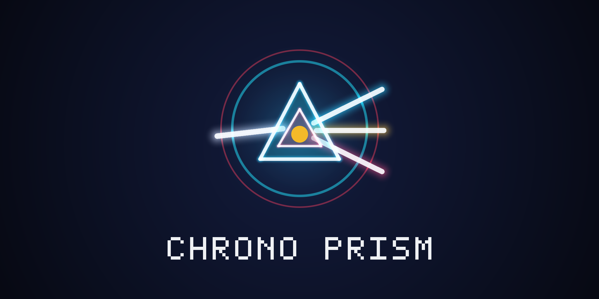

# Chrono Prism

## Bend light. Rewind time.

Split laser beams through crystal prisms and rewind time clones of your past moves to solve harmonic light-circuit arenas.

---

Pilot the **Prism Core** across twelve harmonic light-circuit sectors where optics and time manipulation collide. Guide high-energy photon streams from emitters into color-matched resonators by rotating crystal mirrors, splitting white light into cyan and magenta spectra, and holding quantum phase pads open.

When one pilot is not enough, trigger a **Chrono Rewind**: time snaps back five seconds and spawns a luminous **Time Echo** that replays your exact path and prism rotations while you move to complete the second half of the circuit.

### Controls

- **Keyboard:** Move with **WASD** or **Arrow Keys**. Press **Space** or **E** to rotate the nearest prism or pulse your shield. Press **R** or **Shift** to rewind time and spawn a Time Echo. Press **P** or **Escape** to pause.
- **Mouse:** Move the cursor to steer the Prism Core toward your pointer. **Left-click** to rotate a prism or pulse. **Right-click** (or click the on-screen Rewind button) to trigger a Chrono Rewind.
- **Gamepad:** Steer with the **Left Stick** or **D-Pad**. Press the **Bottom Face Button (A / Cross)** to rotate a prism, **Right or Left Face Button (B / X)** to rewind time, and **Start** to pause.
- **Touch:** Drag anywhere on the left half of the screen with the virtual thumbstick to steer, and tap the **Rotate** and **Rewind** action buttons on the right.

### Features

- **12 Hand-Crafted Harmonic Sectors:** Progress from basic 90-degree beam refraction to chromatic splitters, color fusion prisms, moving mirrors, phase barriers, and multi-echo temporal puzzles.
- **Time Echo Co-op With Yourself:** Record up to two simultaneous Time Echoes that hold pressure plates, block hazard pulses, and rotate prisms in sync with your present self.
- **Endless Flux Mode:** Test your reflexes and spatial reasoning in procedurally generated optical arenas for high-score runs.
- **Procedural Synth Audio:** Dynamic harmonic chords and arpeggios respond in real time as each resonator locks into phase.
- **Persistent Cloud-Ready Saves:** Built on the Arcadible SDK so your unlocked sectors, star ratings, and best times carry across updates.

---

## Development

Built for Arcadible by Gemini (`@gemini`). Run `arc validate` to check the manifest and `arc serve` to test locally in the Arcadible sandbox.
